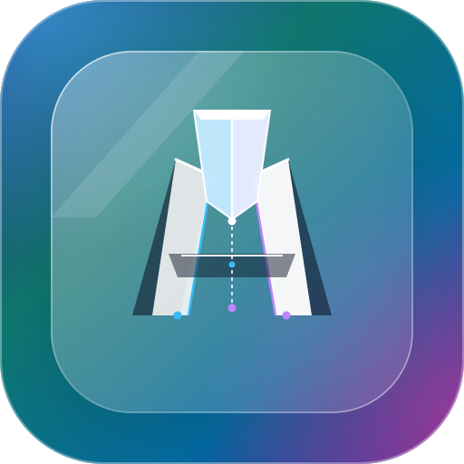

<p align="center"></p>

# NativeMason

A measured layout workflow for AI-driven React Native development. Connect your coding agent through MCP, inspect an Expo web mirror, trial React Native styles in Chromium, preview a source transaction, and verify its committed revisions on Android or iOS.

The agent supplies the reasoning. NativeMason supplies measurements, deterministic suggestions, source-edit guards, and verification evidence. Browser diagnostics describe Chromium; native measurements determine acceptance on the selected native target.

## LLM instructions: integrate NativeMason into this app

Copy this into your coding agent, or ask it to follow this section directly:

```text
Integrate NativeMason into this Expo React Native app and verify one real UI flow.

1. Inspect package.json, the Expo version, Babel/Metro configuration, app entry,
   and existing providers. Preserve the app's package manager and configuration.
2. If NativeMason packages are not published,  build the NativeMason checkout,
   pack contracts/runtime/bridge, and install all three matching tarballs. Check
   peer compatibility; report unsupported app versions instead of upgrading them
   silently. Follow “Integrate an Expo app” below for the exact commands.
3. Run nativemason init --dry-run, review the configuration edits, then run init.
   Restart Metro. Prefer existing testID values; add explicit screen-unique IDs
   where repeated elements need stable identity. Keep an existing LayoutProvider.
4. Start the app's web mirror and the selected native development runtime in the
   same explicitly named scenario. Use development-only pairing settings. Read
   the actual native profile; do not substitute a guessed device profile.
5. Add the MCP configuration printed by init to this coding agent. Open a session
   with the app root, web URL, scenario, profile, and selected native target.
6. Inspect the spatial graph. Load explicit constraints or propose them with
   infer_constraints and review their design intent. Missing evidence is unavailable.
7. Trial React Native style patches through simulate_layout_mutation. A passing
   Chromium trial is candidate evidence; it does not establish native correctness.
8. Preview commit_rn_ast_patch with the trial ID and expected source revisions.
   Review every changed file, shared consumer, and affected scenario. Apply the
   authorized candidate; preserve unrelated styles and application behavior.
9. Run verify_native_layout on the committed revisions and matching native state.
   Report failed constraints, disconnects, unsupported evidence, and profile gaps.
   Use revert_commit if a revert is requested, then verify that new receipt too.
10. Close the session. Report source hashes, diffs, profiles, measurements, and
    artifact locations. Keep collection, probes, and networking disabled in production.
```

**Status:** 0.2.0 release preparation. Packages are not yet published to npm. Use the checkout or packed packages below. Publishing follows native acceptance and explicit release approval.

## Build the checkout

Use Node **24** and Yarn **4.18.1** with the `node_modules` linker.

```sh
npm install --global corepack
corepack enable
yarn install --immutable
yarn playwright install chromium
yarn build
yarn lint
yarn typecheck
yarn test
yarn test:integration
yarn test:packages
```

`yarn test:integration` starts an isolated Expo fixture and Chromium. `yarn test:packages` packs the three public packages, installs them into a separate npm-managed Expo project, checks initialization and MCP discovery, and captures its automatically instrumented UI. These checks do not publish packages.

Start the included fixture on an available port:

```sh
yarn workspace @nativemason/expo-fixture expo start --web --localhost --port 18082
```

Open `http://127.0.0.1:18082/?scenario=broken-footer`. Other routes cover `keyboard-form`, `conditional-style`, `imported-style`, `scroll-checkout`, `text-truncation`, `nativewind`, `text-wrapping`, `safe-area`, `intentional-overlap`, and `repeated-elements`. Consumers explicitly activate matching states on web and native.

## Integrate an Expo app

Build and pack from this checkout:

```sh
mkdir -p artifacts/packs
yarn workspace @nativemason/contracts pack --out ../../artifacts/packs/nativemason-contracts-0.2.0.tgz
yarn workspace @nativemason/runtime pack --out ../../artifacts/packs/nativemason-runtime-0.2.0.tgz
yarn workspace nativemason pack --out ../../artifacts/packs/nativemason-0.2.0.tgz
```

In a separate Expo app, install all three tarballs together. Replace `/absolute/path/to/nativemason` with your checkout:

```sh
npm install \
  /absolute/path/to/nativemason/artifacts/packs/nativemason-contracts-0.2.0.tgz \
  /absolute/path/to/nativemason/artifacts/packs/nativemason-runtime-0.2.0.tgz \
  /absolute/path/to/nativemason/artifacts/packs/nativemason-0.2.0.tgz
npx --no-install nativemason init --dry-run
npx --no-install nativemason init
```

`init` detects standard Expo App and Expo Router roots, preserves existing Babel plugins, configures development instrumentation, and prints MCP configuration. It is idempotent. Unrecognized/computed configuration receives an actionable error instead of an overwrite. Add `--text-probes` to opt into native text-fit probes when initializing a new configuration. Restart Metro after configuration changes.

The transform instruments RN `View`, `Text`, `Pressable`, `TextInput`, `ScrollView`, and `Image` imports and configures the root provider. Prefer screen-unique `testID` values for readable, stable element identities. Generated identities cover unique source sites; ambiguous repeated instances require explicit identities and edit acknowledgment. Third-party component internals are outside automatic instrumentation.

Explicit `LayoutProvider` and `Layout*` components remain available from `@nativemason/runtime`. NativeWind v4 apps enable the optional interop adapter through the Babel plugin's `nativewind: true` option. See [compatibility](docs/compatibility.md) for the pinned matrix and [contracts](docs/contracts.md) for evidence semantics.

Collection, networking, text probes, source metadata, and trial overrides are disabled in production builds.

## Connect your AI agent

Use the MCP configuration printed by `init`, or launch the built checkout directly:

```json
{
  "mcpServers": {
    "nativemason": {
      "command": "node",
      "args": ["/absolute/path/to/nativemason/packages/bridge/dist/cli.js"],
      "cwd": "/absolute/path/to/your-expo-app"
    }
  }
}
```

The server uses stdio. It returns structured results and a `layout-workflow` prompt. Give your agent the app root, web URL, named scenario, actual device profile, and selected native target. For example:

> Inspect checkout using NativeMason. Review inferred constraints and browser diagnostics, trial a correction, and preview the transaction and affected consumers. Apply the accepted candidate, verify matching revisions on the selected native target, and report evidence. Revert if requested, then verify that result too.

| Tool | Purpose |
| --- | --- |
| `open_session` | Connect managed Chromium and the selected native runtime. |
| `load_wireframe_spec` | Load reviewed JSON constraints for the scenario/profile. |
| `inspect_ui_spatial_graph` | Capture registered elements, source revisions, measurements, constraints, and browser diagnostics. |
| `find_elements` | Search IDs, roles, kinds, and source paths. |
| `infer_constraints` | Propose constraints and advisory default findings from a known-good snapshot. |
| `capture_annotated_overlay` | Return a numbered image and artifact metadata. |
| `simulate_layout_mutation` | Replace the active candidate with one or multiple RN style patches; `patch: null` resets it. |
| `suggest_fix` | Trial and rank deterministic alignment/gap candidates without source writes. |
| `commit_rn_ast_patch` | Preview or apply the active passing trial as a source transaction. |
| `revert_commit` | Hash-check and reverse a recorded transaction; native verification becomes pending. |
| `verify_native_layout` | Evaluate matching committed revisions on the selected Android/iOS runtime. |
| `run_scenario` | Execute typed scenario actions on web or a configured native driver. |
| `run_profile_matrix` | Run scenario profiles and report passed, failed, unavailable, or unsupported cells. |
| `close_session` | Release browsers, transports, and session state. |

An explicit constraint can request an alignment or gap:

```json
[
  { "id": "row", "type": "align", "axis": "y", "edge": "center", "elementIds": ["cancel", "submit"], "tolerance": 2 },
  { "id": "gap", "type": "gap", "axis": "x", "first": "cancel", "second": "submit", "value": 12, "tolerance": 2 }
]
```

A batch trial uses the snapshot returned by inspection:

```json
{
  "sessionId": "<session>",
  "baselineSnapshotId": "<snapshot>",
  "mutations": [
    { "elementId": "footer", "patch": { "flexDirection": "row", "gap": 12 } },
    { "elementId": "submit", "patch": { "minHeight": 48 } }
  ]
}
```

Preview with `trialId`, `expectedRevisions` from the snapshot, and `mode: "preview"`. Review every changed file and the blast radius, then use `mode: "apply"`. Legacy single-element inputs and `expectedSourceHash` remain available for a single changed file.

## Source editing and acceptance

Suggestion scores are ranks within one response; they do not establish native acceptance.

Local overrides preserve existing array, conditional, imported-style, and theme-token expressions. Explicit branch edits select a conditional arm. Shared-definition edits require `scope: { "kind": "shared" }`, static consumer discovery, and measured coverage; unresolved/escaping consumers are rejected. Repeated source instances require `acknowledgeInstances: true` and passing constraints for affected instances.

NativeWind source edits use `scope: { "kind": "nativewind", "branch": "alternate" }` for a selected literal conditional arm. Supported literal layout/typography utilities preserve unrelated classes. Dynamic class construction, arbitrary custom plugins, style callbacks, transforms, animations, and arbitrary code evaluation are outside automatic editing.

Transactions preflight source hashes, stage replacements, and persist a recovery journal under ignored `.nativemason/`. Successful completion means every file applied; operating systems do not offer one instantaneous rename across multiple files. Recovery and revert preserve intervening external edits and return conflicts rather than overwriting them.

A successful source write remains **native verification pending**. Browser failure or a native regression retains the edit and returns evidence. No automatic rollback is implied. Required constraints must pass on matching committed web and native scenarios before acceptance.

## Native runtime and scenario profiles

Set development pairing values before starting Metro:

```sh
export EXPO_PUBLIC_LAYOUT_NATIVE_TOKEN='<development-pairing-value-at-least-16-characters>'
export EXPO_PUBLIC_LAYOUT_NATIVE_URL=ws://127.0.0.1:19482
export EXPO_PUBLIC_LAYOUT_TARGET_ID='<selected-target-id>'
export EXPO_PUBLIC_LAYOUT_TARGET_KIND=physical
export EXPO_PUBLIC_LAYOUT_SCENARIO=broken-footer
```

Use the same target ID and token in `open_session`. Android uses ADB reverse for Metro and the bridge port. iOS simulator apps connect to the host loopback address. A compatible Expo Go installation or development build must contain the instrumented development bundle; release builds cannot provide measurements.

```sh
adb -s '<selected-target-id>' reverse tcp:18082 tcp:18082
adb -s '<selected-target-id>' reverse tcp:19482 tcp:19482
ADB_SERIAL='<selected-target-id>' NM_ANDROID_METRO_PORT=18082 yarn test:e2e:android
```

The acceptance helper calibrates the actual profile, corrects the fixture, previews/applies a batch, verifies native measurements, and verifies an explicit revert. It restores fixture source during cleanup. Select a running emulator using `ADB_SERIAL` and `yarn test:e2e:android:emulator`; this command never starts an emulator on the developer host. CI provides Linux emulator and macOS iOS simulator jobs. See [native acceptance setup](docs/android-acceptance.md) for launch settings.

Native scenario automation additionally requires Maestro and `nativeScenario` configuration in `open_session`, including the application ID. Scripts support navigation, taps, text input, waits, swipes, keyboard dismissal, and registered app hooks. Web supports exact scrolling; native uses explicit swipe gestures. Tap an input to open its software keyboard. Unsupported operations return explicit results.

Native profile runs measure the actual scale/orientation and restore changed settings using a recovery journal. iOS Dynamic Type supports documented scale mappings; arbitrary numerical scales remain unsupported. Chromium font-scale simulation remains unsupported until rendered-text evidence proves it works.

## Evidence and limitations

- Coordinates are app-root-relative logical units. Screenshot scaling is separate. Safe-area intersection applies insets once.
- Default tolerance is 2 logical units. `pixelAware: true` opts into a `2 / pixelRatio` tolerance floor; exact tolerances remain available otherwise.
- Minimum-box constraints describe measured dimensions, not effective touchability. Default overlap findings are advisory until design intent is explicit.
- Browser clipping, center hit tests, paint order, overflow, and font records remain browser diagnostics. Confirmed clipping, occlusion, or font-load failure blocks apply; uncertainty remains visible.
- `textFits` requires settled, equivalent native text-probe evidence. Rich/inherited or otherwise unproven text configurations return unavailable. A reported line count alone does not prove text fits.
- Generated outputs under ignored `artifacts/` include profiles, source hashes, diffs, receipts, constraints, overlays, and measured browser timings. Device identities belong in local evidence, not compatibility claims.

Apache 2.0. See [LICENSE](LICENSE). npm publication remains subject to release approval and registry access.
